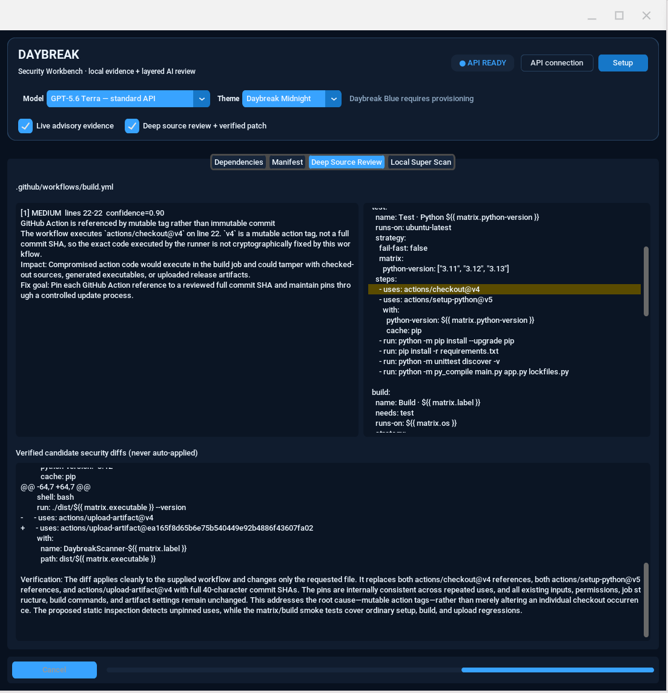
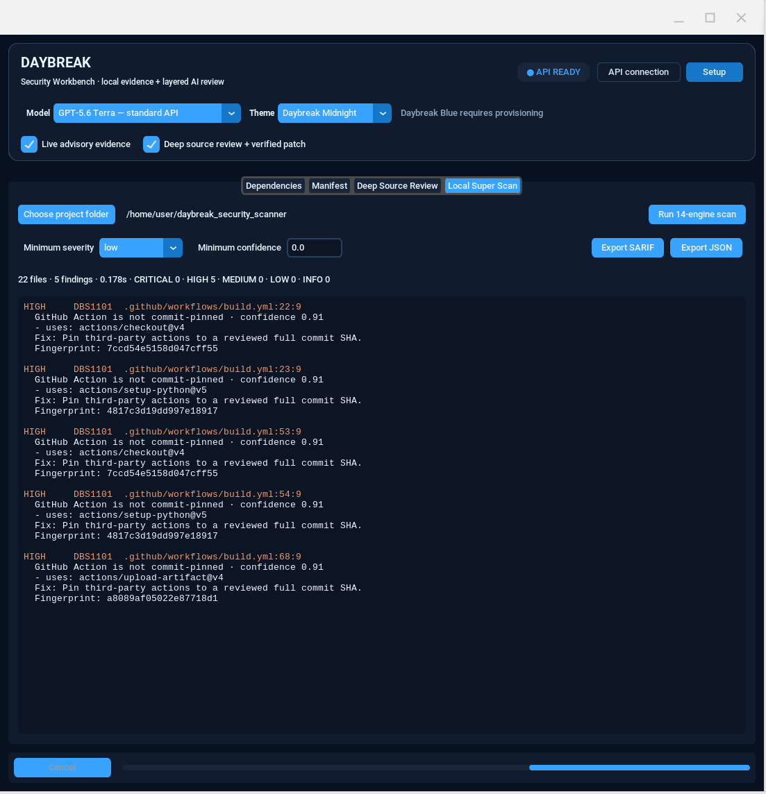
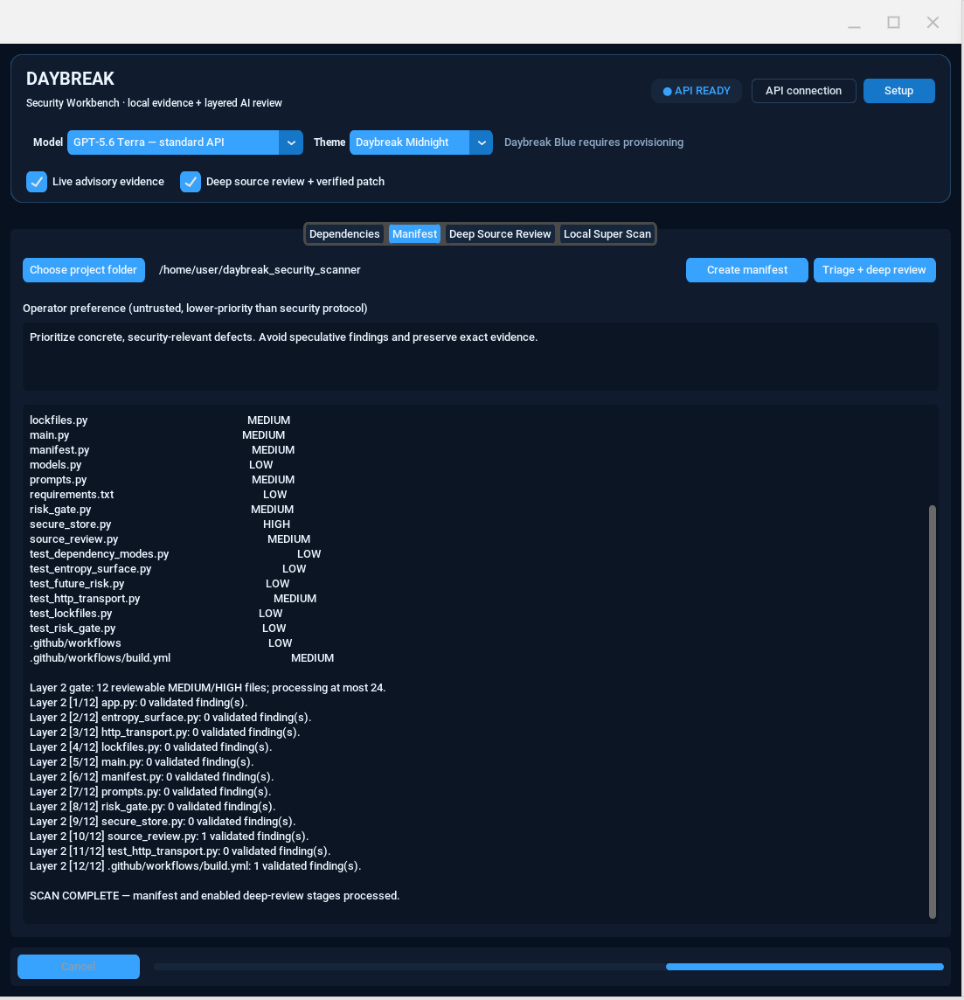
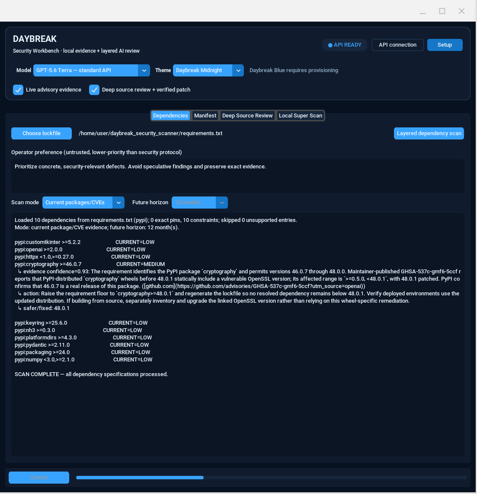
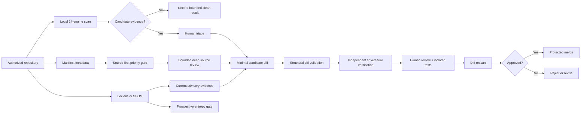
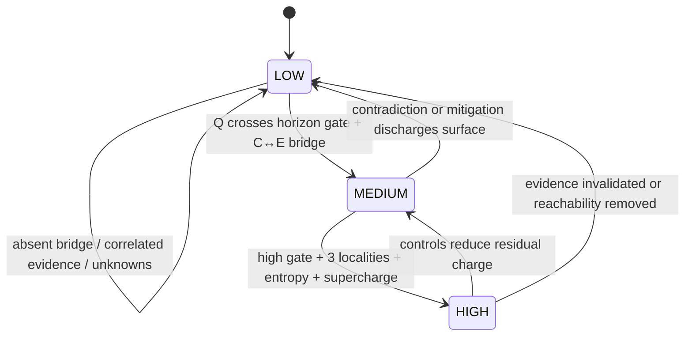
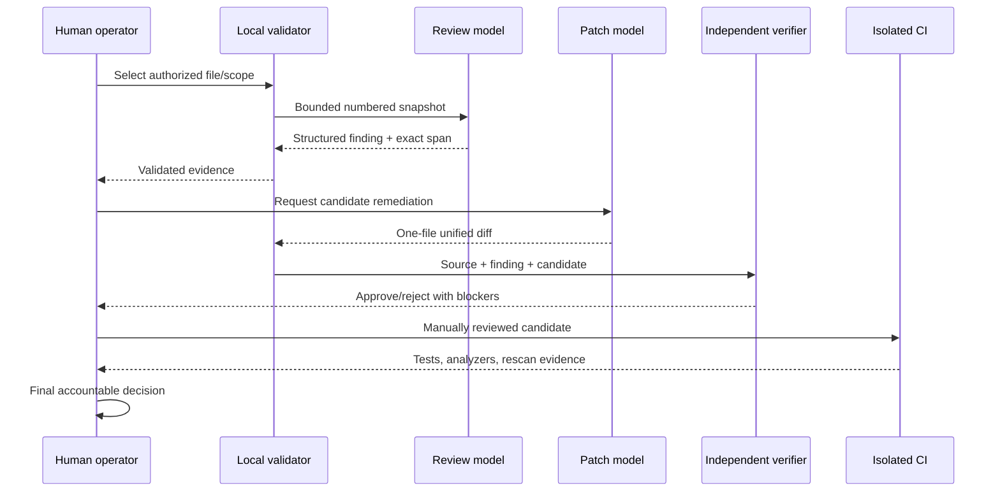
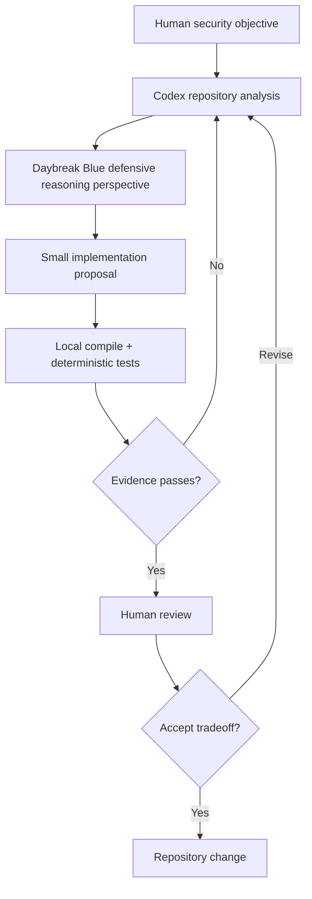

# Daybreak Super Scanner

`main.py` is now the unified launcher for three interfaces. Its scanner core runs
14 local evidence engines without executing target code or sending source
off-machine.

```bash
python3 main.py --cli /path/to/project
python3 main.py --tui /path/to/project
python3 main.py --gui
python3 main.py --cli . --format sarif --output daybreak.sarif
python3 main.py --cli . --severity medium --fail-on high
python3 main.py --list-engines
python3 main.py --list-ideas
```

- `--cli` provides stable output, atomic report writes, baselines, engine filters,
  concurrency controls, and CI exit gates. Omitting a mode remains a backwards-
  compatible alias for CLI mode.
- `--tui` opens an interactive dashboard with severity counts, keyboard navigation,
  responsive finding details, redacted source context, live rescans, severity and
  confidence filters, text search, three sort modes, baseline visibility, and
  timestamped JSON/SARIF export. Press `?` inside it for help.
- `--gui` launches the CustomTkinter security workbench. Its **Local Super Scan**
  tab runs the same 14 deterministic engines as CLI/TUI without an API key, with
  severity/confidence filters, color-coded evidence, and JSON/SARIF export. The
  other tabs retain the layered AI dependency, manifest, source, patch, and
  adversarial-verification workflows.

## Visual tour

These screenshots are real demonstration runs against this repository. They illustrate the
workflow and presentation, not a claim that every highlighted condition is exploitable.

### 1. Deep source review and verified candidate diff



The Deep Source Review workspace keeps three artifacts adjacent but logically separate:

- **Finding evidence** identifies the smallest locally validated source span, severity,
  confidence, security impact, and remediation objective.
- **Source context** highlights the cited lines in the exact bounded snapshot that was sent
  for review. Treat the highlight as a review pointer—not proof of exploitability.
- **Verified candidate diff** is displayed only after local diff validation and an independent
  model verification stage approve its structure and stated security goal. “Verified” means
  the candidate passed those bounded checks; it does not mean the patch is production-safe.

In this demonstration, mutable GitHub Action tags were identified as a build-provenance risk.
The proposed diff replaces them with full commit identifiers while preserving workflow inputs.
Daybreak does not apply the patch, commit it, push it, or approve deployment.

### 2. Source-first manifest triage



The Manifest workspace first transmits metadata—not source contents—to assign review priority.
When **Deep source review + verified patch** is enabled, only bounded MEDIUM/HIGH source
candidates proceed to content review. Production implementation is considered before tests,
configuration, and workflow files. The progress ledger records every reviewed candidate and
the number of findings that survived local line-span and confidence validation.

LOW in this view means low *review priority from the available evidence*. It is not a security
certification. Likewise, zero validated findings means the bounded review produced no claim
meeting its evidence threshold; it does not establish absence of vulnerabilities.

### 3. Deterministic Local Super Scan



Local Super Scan executes fourteen deterministic evidence engines without an API key and
without transmitting repository content. Each result includes an engine/rule identifier,
location, confidence, redacted evidence, remediation guidance, and stable fingerprint.
The screenshot uses repository-wide coverage and therefore reports mutable GitHub Action tags.
For day-to-day code work, select **Application source**; use **CI / infrastructure** for
workflows and deployment files, or **Full repository** for release-gate coverage.

SARIF is intended for code-scanning ingestion; JSON preserves the complete Daybreak result
document. A fingerprint baseline records an explicitly accepted result but does not fix it.

### 4. Current dependency and CVE evidence



The Dependencies workspace parses a selected manifest or lockfile locally, preserves its
ecosystem identity, and distinguishes exact pins from constraints. In this demonstration,
**Current packages/CVEs** mode suppresses future forecasting and concentrates API work on
present advisory applicability. A MEDIUM result receives a second evidence pass that records:

- the normalized registry identity (`pypi:cryptography` rather than an ambiguous bare name);
- whether the supplied constraint can select an affected version;
- evidence confidence and the conditions limiting that conclusion;
- a concrete defensive action and the smallest established safer version floor.

Layer-1 MEDIUM/HIGH values are labeled **TRIAGE** when an evidence dossier is scheduled. The
dossier returns `applicable` plus a schema-validated **FINAL CURRENT** rating. If an exact pin is
newer than every confirmed affected range, the final rating must be LOW; the schema rejects a
non-applicable advisory that attempts to retain MEDIUM/HIGH.

The screenshot contains a constraint, not a resolved lock. Consequently, the conclusion is
about versions the resolver *may* select. Confirm the running artifact, build method, transitive
graph, platform, and linked native libraries before treating the result as deployment impact.
Use **Future horizon only** for control-planning forecasts, or **Current + future** when both
questions justify the added latency and API use.

## Safe operating procedure

Daybreak is a defensive decision-support system. Its models and regex engines are deliberately
not security authorities. Use the following control sequence for repositories you own or are
explicitly authorized to assess:

1. **Establish scope and authorization.** Select the narrowest authorized repository or file.
   Exclude unrelated secrets, customer data, generated artifacts, and third-party code you are
   not permitted to transmit or assess.
2. **Start locally.** Run Application Source first, then CI/Infrastructure. Local results are
   fast, reproducible triage signals and reveal obvious boundaries before any source leaves the
   machine.
3. **Use exact dependency state.** Prefer lockfiles and production SBOMs over broad version
   ranges. A range describes what a resolver may choose, not what is deployed.
4. **Minimize transmission.** Leave deep review disabled until metadata triage identifies a
   justified candidate. Enabling deep review intentionally sends bounded source snapshots to
   the configured API project. Review organizational data-handling requirements first.
5. **Challenge every finding.** Confirm package identity, installed version, attacker-controlled
   input, reachable sink, existing guards, privileges, and realistic impact. Confidence is an
   evidence-quality signal—not exploit probability.
6. **Treat forecasts as scenarios.** Future LOW/MEDIUM/HIGH ratings are control-planning bands,
   never evidence of a zero day. Unknowns add uncertainty rather than risk charge; the local
   entropy gate can downgrade unsupported model escalation.
7. **Review diffs manually.** Inspect the entire patch and surrounding code, verify every action
   commit against its upstream release when applicable, run formatting/static analysis/tests,
   rebuild in an isolated environment, and rescan the resulting diff.
8. **Require independent approval.** A different authorized reviewer should approve security
   changes before merge. Use protected branches, least-privileged CI tokens, immutable action
   pins, and environment approval gates.
9. **Handle secrets as compromised evidence.** If a credential appears in output, revoke and
   rotate it; redaction in the report does not undo earlier exposure. Never paste API keys into
   prompts, reports, screenshots, issues, or commits.
10. **Preserve an audit trail.** Retain the selected scope, scanner version, mode, model, exact
    dependency state, report, human disposition, tests, and final reviewed diff. Re-run the scan
    after meaningful source, dependency, build, or infrastructure changes.

### Trust boundaries and interpretation

| Surface | Runs locally | May transmit content | Safe interpretation |
|---|---:|---:|---|
| Local Super Scan | Yes | No | Deterministic candidate evidence within enabled rules |
| Manifest triage | Metadata preparation is local | Paths/types/sizes may be sent | Review priority, not vulnerability existence |
| Deep Source Review | Snapshot validation is local | Selected bounded source is sent | Evidence-backed candidate requiring human validation |
| Dependency evidence | Lockfile parsing is local | Normalized package specifications are sent | Advisory applicability depends on exact deployed state |
| Future-risk horizon | Entropy gate is local | Package evidence may be retrieved/processed | Comparative planning forecast, never a predicted CVE |
| Candidate patch | Structural checks are local | Finding, source, and diff are sent | Unapplied proposal requiring tests and approval |

Use a dedicated API project and least-privileged key. Store it through the encrypted setup flow
where the platform credential vault is available; do not commit `.env` files or screenshots
containing credentials. The **API READY** indicator confirms key availability only—it does not
prove billing, model entitlement, organizational approval, or authorization to scan a target.

## Applying Daybreak to secure a repository

Daybreak is most effective as a sequence of progressively more expensive evidence gates. It is
not intended to replace compiler diagnostics, tests, dependency resolution, specialist static
analysis, penetration testing, threat modeling, or human review. Its role is to connect these
activities into an evidence-preserving decision pipeline.



### Repository onboarding model

1. **Define the security envelope.** Document owners, authorized targets, protected assets,
   attacker capabilities, trust boundaries, excluded data, and required security properties.
   Keep third-party systems outside scope unless their license and your authorization permit
   assessment.
2. **Create an immutable observation point.** Scan a named commit or clean worktree. Capture the
   commit identifier, scanner version, selected engines, model, dependency lock hash, operating
   mode, and time. Without this, later findings cannot be reproduced reliably.
3. **Run local profiles separately.** Application Source answers a different question from
   CI/Infrastructure. Separating them prevents workflow hygiene from hiding application defects
   while preserving both result sets for the final gate.
4. **Resolve dependencies exactly.** Generate the ecosystem-native lockfile in a trusted build
   environment. Compare the lockfile to the deployed SBOM; scanners cannot infer runtime state
   from a broad manifest alone.
5. **Escalate minimally.** Start with metadata and deterministic evidence. Transmit only the
   source files necessary to resolve a concrete question, never the repository by default.
6. **Validate causal reachability.** A dangerous function is not automatically a vulnerability.
   Establish an attacker-controlled source, propagation path, reachable sink, missing or broken
   guard, required privilege, and plausible impact.
7. **Patch the invariant, not the symptom.** State the security property that must hold after
   remediation. Prefer a narrow patch that restores that property without broad exception
   handling, unsafe fallback behavior, or unrelated refactoring.
8. **Test adversarially.** Add a regression that fails before the fix and passes afterward,
   boundary and malformed-input tests, and ordinary compatibility tests. Run them in an isolated
   environment with no production credentials.
9. **Rescan the final diff.** Scan the exact patch that will merge. A safe proposal can become
   unsafe after conflict resolution, formatting, generated-code updates, or dependency changes.
10. **Operate the control.** Assign advisory ownership, patch SLAs, exception expiry, artifact
    provenance checks, and periodic rescanning. Repository security is a maintained process, not
    a one-time score.

### Deployment patterns

| Repository type | Start with | Escalate when | Required independent evidence |
|---|---|---|---|
| Web/API service | Application Source + lockfile | Input reaches auth, database, filesystem, parser, template, or network sink | Route tests, authorization matrix, integration tests, deployed SBOM |
| CLI/developer tool | Application Source + CI | Arguments or project files reach shell, archive, path, plugin, or update logic | Malicious fixture corpus, sandbox tests, release provenance |
| Library/SDK | Full Repository + supported-version matrix | Public API crosses serialization, crypto, transport, callback, or native boundary | Compatibility matrix, API invariant tests, downstream impact review |
| Infrastructure repository | CI/Infrastructure | Workflow token, cloud identity, artifact, secret, or deployment boundary changes | Policy-as-code, least-privilege diff, ephemeral-environment plan |
| Monorepo | Per-component scans + shared CI | A finding crosses package ownership or privilege boundaries | Component owners, dependency graph, affected-build calculation |
| Security-sensitive parser | Source Review + fuzz corpus | Untrusted bytes reach memory-unsafe or highly stateful parsing logic | Fuzzing, resource caps, sanitizers, differential tests |

## Entropy-bounded prospective-risk mechanics

The prospective-risk system is a classical NumPy calibration layer. It is not quantum
computing, a probability of compromise, or a predictor of undisclosed vulnerabilities. Its
purpose is narrower: prevent a language model from converting generic concern, repeated claims,
or missing deployment information into an unjustified MEDIUM/HIGH horizon rating.

For evidence signal \(i\), the initial charge is:

$$
q_i = \operatorname{clip}(s_i,0,1)\operatorname{clip}(c_i,0,1)
$$

where \(s_i\) is claimed strength and \(c_i\) is evidence confidence. Signals belong to exactly
one locality: capability \(C\), exposure \(E\), resilience \(R\), or trajectory \(T\).
Unknown facts create no positive charge.

### 1. Locality repulsion

Evidence text is transformed locally into a deterministic signed feature vector using bounded
feature hashing. Within the same polarity and locality, the maximum cosine similarity to an
accepted signal is \(\rho_i\). Retained charge is:

$$
q_i' = q_i\left(1-0.82\operatorname{clip}(\rho_i,0,1)\right)
$$

Thus, copying one claim ten times cannot emulate ten independent facts. Feature hashing is used
for bounded local deduplication, not semantic truth determination; collisions and paraphrase
misses remain possible.

### 2. Contradiction capacitors

Positive and opposing charges are accumulated separately inside each locality:

$$
S_d=\sum q_{i,d}^{'+},\qquad O_d=\sum q_{i,d}^{'-}
$$

The unresolved contradiction charge and flowing charge are:

$$
K_d=\min(S_d,O_d),\qquad N_d=\max(0,S_d-O_d)
$$

The mechanism retains disagreement as uncertainty instead of averaging it into artificial
confidence. Mitigating or contradictory evidence can reduce a charge, but cannot create a
negative risk assertion.

### 3. Evidence charge lattice

Each locality is capped and weighted:

$$
D_d=w_d\min(1,N_d),\qquad
(w_C,w_E,w_R,w_T)=(1.0,1.0,0.8,0.65)
$$

Let \(z_d=D_d/w_d\), and let \(M\) be a fixed directed coupling matrix with a zero diagonal.
The lattice corroboration term is:

$$
L=\frac{1}{4}\sum_d z_d\left(\sum_j z_jM_{j,d}\right)
$$

Multiplication by destination charge means the lattice cannot populate an empty locality. A
capability signal can strengthen an already evidenced exposure relationship, but it cannot
invent reachability.

### 4. Diversity entropy and bounded charge

For active localities \(A=\{d:D_d\ge0.18\}\), define
\(p_d=D_d/\sum_{j\in A}D_j\). Normalized diversity entropy is:

$$
H=-\frac{\sum_{d\in A}p_d\ln p_d}{\ln 4}
$$

The pre-supercharge value is approximately:

$$
Q=\operatorname{clip}_{[0,1]}\left[
\frac{\sum_{d\in A}D_d}{\sum_dw_d}
(0.72+0.28H)(0.65+0.35c_f)
\right]
$$

The implementation applies the diversity and confidence terms multiplicatively to the base
fraction, then adds at most \(0.10\) from lattice corroboration and subtracts at most \(0.18\)
from stored contradiction charge. The expanded implementation form is:

$$
Q=\operatorname{clip}_{[0,1]}\left[
\frac{\sum D_d}{\sum w_d}(0.72+0.28H)(0.65+0.35c_f)
+\min(0.10,0.35L)-\min(0.18,0.20\sum K_d)
\right]
$$

### 5. Bridge-gated supercharge

Supercharge is permitted only when capability and exposure both have at least \(0.45\) charge,
three or more localities are active, and \(H\ge0.55\). Then:

$$
Q_s=\min(1,1.18Q+0.08)
$$

Otherwise \(Q_s=Q\). Even a supercharged result cannot exceed the model’s requested band; the
local gate is allowed to downgrade, never upgrade. A current LOW rating at a one-month horizon
remains LOW unless \(Q_s\ge0.82\).

| Horizon | MEDIUM gate | HIGH gate |
|---:|---:|---:|
| 1 month | 0.72 | 0.92 |
| 6 months | 0.66 | 0.89 |
| 12 months | 0.61 | 0.86 |
| 36 months | 0.56 | 0.82 |

Longer horizons lower the gate modestly because constraint aging and patch latency have more
time to become observable. Time itself supplies no charge: trajectory requires a concrete,
falsifiable mechanism and present evidence.



## Predictive patch mechanics

Predictive patching means anticipating how a proposed remediation could fail under future
callers, inputs, dependencies, and maintenance—not predicting that a vulnerability will occur.
Daybreak models a patch as a candidate transformation \(P:S\rightarrow S'\) over source snapshot
\(S\). A candidate is displayable only when bounded gates hold:

$$
A(P)=G_{path}\land G_{scope}\land G_{syntax}\land G_{lines}\land V_{root}\land V_{regression}
$$

- \(G_{path}\): exactly one expected relative file; no traversal, rename, creation, or deletion.
- \(G_{scope}\): the change addresses the stated remediation invariant rather than unrelated
  cleanup.
- \(G_{syntax}\): the artifact is structurally a unified diff with coherent headers and hunks.
- \(G_{lines}\): changed-line count remains below the local cap.
- \(V_{root}\): independent verification concludes the patch addresses the root cause.
- \(V_{regression}\): no obvious new injection, secret, unsafe fallback, or trust-boundary
  regression is identified from the supplied snapshot.

This predicate is necessary but insufficient. Compilation, tests, fuzzing, runtime policy,
dependency compatibility, and human approval remain outside the model verifier’s proof boundary.



## Development with Codex and Daybreak Blue

Daybreak Super Scanner is an independent project, not an official OpenAI security product. Its
implementation was developed iteratively in a Codex workspace: the human operator supplied the
security goals and accepted tradeoffs; Codex inspected and edited the repository, ran tests,
reproduced failures, and converted feedback into reviewable changes. Daybreak Blue was used as a
defensive security reasoning perspective where available. Model output remained advisory; local
Python validation, tests, and operator decisions defined what entered the codebase.

That development loop mirrors documented Codex engineering workflows: understanding codebases,
running authorized deep security scans, reviewing code changes, remediating reviewed findings,
and iterating through scored improvement loops. See the
[official OpenAI Codex use cases](https://learn.chatgpt.com/use-cases) for the current product
descriptions. Model availability in Codex does not imply that the same model identifier is
provisioned for an API project; the GUI therefore treats API model access as a separate runtime
capability.



The concept emerged through repeated correction rather than one prompt: Python-only dependency
input became a multi-ecosystem lockfile layer; sequential web dossiers became gated concurrent
depth modes; speculative one-month MEDIUM forecasts produced the entropy-bounded calibration
surface; workflow-only local output led to separated scan profiles; and source-review ordering
became source-first with direct file selection. This history is important: each architecture
element addresses an observed failure mode, but none should be mistaken for formal verification.

### Reproducing the development discipline

- Ask Codex to inspect before changing and require an evidence-backed explanation of the current
  behavior.
- Keep each requested change bounded; review local diffs and preserve unrelated user work.
- Encode every repaired invariant as a deterministic regression test where practical.
- Use a second security review path for candidate patches, then test independently of both model
  passes.
- Do not grant a model merge, deployment, credential, disclosure, or target-authorization
  authority merely because it generated a convincing explanation.
- Record false positives and false negatives as calibration fixtures. A scanner improves through
  measured error correction, not by increasing severity or verbosity.

## Security interpretation limits

Daybreak cannot prove a repository secure. Static text patterns miss dataflow and runtime state;
models can hallucinate evidence or overlook guards; advisory sources can be incomplete; version
ranges do not reveal installed artifacts; generated diffs can break behavior; and future-risk
bands are heuristic planning outputs. Native code, generated code, macros, build-time behavior,
plugins, environment configuration, external services, and deployment identity can alter the
real attack surface substantially.

Use findings as hypotheses with preserved evidence. The strongest conclusion Daybreak can make
is bounded: under the selected scope, inputs, versions, enabled engines, source snapshot, model,
and confidence gates, a specific candidate did or did not survive the configured review process.

Local Super Scan separates **Application source**, **Full repository**, and
**CI / infrastructure** profiles so workflow hygiene cannot monopolize application-code
results. Findings are grouped by engine; a clean result lists completed engines and examined
files instead of presenting an empty panel. Deep Source Review can now inspect a directly
selected file, while project review ranks production implementation ahead of tests, metadata,
configuration, and GitHub workflows.

On first launch, a two-step startup flow explains local-only and AI-assisted modes,
then optionally stores the API key with AES-GCM while the master key remains in the
OS credential vault. Operators may continue without a key and use the deterministic
scanner. The wizard can be reopened from the main toolbar.

Six live GUI themes are included: Daybreak Midnight, Cyber Neon, Violet Horizon,
Solar Flare, Arctic Light, and High Contrast. Theme changes restyle the workbench
and startup wizard without restarting the application.

The v3.6 workbench uses a compact command header: connection state and setup actions
sit beside the product identity, model and theme share one toolbar, scan options are
grouped together, and manual API-key editing stays collapsed until requested. This
keeps the tab workspaces focused on scan inputs and evidence.

## Multi-ecosystem dependency intelligence

The dependency workspace accepts exact lockfiles and manifests without executing package
manager code. Supported sources include Python requirements, Pipfile/Poetry/uv; npm,
TypeScript and JavaScript package-lock/yarn/pnpm; Rust Cargo; Go modules; Dart/Flutter;
PHP Composer; Ruby Bundler; NuGet/Paket; Maven/Gradle; Swift Package Manager and CocoaPods;
plus Conan and vcpkg for C/C++. Records are normalized as
`ecosystem:package==version`, preserving the registry identity and the distinction between
an exact resolved pin and a version constraint.

Its scan-mode selector supports **Current packages/CVEs**, **Future horizon only**, and
**Current + future**. Unselected deep-analysis stages are not called: current-only skips the
forecast and entropy-surface review, while future-only skips current-CVE evidence expansion.

Dependency depth defaults to **Fast**, which performs one batched classification plus local
entropy calibration and skips verbose per-package web dossiers. **Balanced** runs escalated
dossiers with up to four bounded concurrent workers; **Exhaustive** uses two workers to reduce
API pressure. Progress reports every completed dossier. Cancel closes the active HTTP pool,
cancels queued work without waiting, and interrupts retry backoff.

## Cross-platform builds

`.github/workflows/build.yml` runs the test suite on Python 3.11–3.13, then produces a
single unified `DaybreakScanner` executable for Windows x86-64, Linux x86-64, macOS
Apple Silicon, and macOS Intel. Each artifact supports `--cli`, `--tui`, and `--gui` and
is retained by GitHub Actions for 14 days. Tagged builds run the same hardened pipeline.

The GUI model dropdown supports:

- `gpt-5.6-terra` for standard API projects and full scanner functionality.
- `daybreak-blue-latest` for API projects separately approved and provisioned for
  the Daybreak program.

The selected model applies consistently to dependency triage, dependency evidence,
source review, patch generation, and adversarial patch verification. If it returns
`model_not_found`, the existing compatibility fallback remains available.

Reports support text, JSON, SARIF 2.1.0, and standalone HTML. Stable finding
fingerprints make accepted-risk baselines reproducible:

```bash
python3 main.py --cli . --write-baseline .daybreak-baseline.json
python3 main.py --cli . --baseline .daybreak-baseline.json
```

Use `# daybreak: ignore` on a line for a narrow, reviewable local suppression.
Run `python3 main.py --help` for engine selection, concurrency, file limits, and
CI exit-gate options. `--confidence 0.8` can suppress lower-confidence heuristic
signals consistently in CLI reports and at TUI startup.

The 15-item experimental research track is documented in `EXPERIMENTS.md`. These
ideas are intentionally separated from production findings until they pass the
promotion gate described there.

## HTTP transport resilience

Remote AI stages use one explicit pooled `httpx.Client` with separate connect,
read, write, and pool timeouts. A single bounded retry layer handles connection
failures and HTTP 408/409/425/429/5xx responses, honors `Retry-After` and
`retry-after-ms`, adds exponential jitter, caps total backoff, and stops promptly
when the operator cancels. Authentication, permission, and malformed requests are
never retried. Configure it with:

```bash
export DAYBREAK_HTTP_ATTEMPTS=5
export DAYBREAK_HTTP_BASE_DELAY=0.6
export DAYBREAK_HTTP_MAX_DELAY=15
export DAYBREAK_HTTP_DELAY_BUDGET=45
export DAYBREAK_HTTP_CONNECT_TIMEOUT=5
export DAYBREAK_HTTP_READ_TIMEOUT=90
export DAYBREAK_HTTP_WRITE_TIMEOUT=30
export DAYBREAK_HTTP_POOL_TIMEOUT=5
```

## Legacy layered AI GUI

This version turns the original metadata/dependency triage client into a gated multi-stage defensive review pipeline.

## Pipeline

1. **Layer 1 — Triage Router**
   - Dependencies: LOW / MEDIUM / HIGH likelihood for exact pins or declared version ranges.
     Range analysis never pretends the installed version is known.
   - Dependencies also receive a separate prospective risk band over a configurable
     1-, 6-, 12-, or 36-month horizon.
   - Manifest: LOW / MEDIUM / HIGH **review priority only** from metadata.
2. **Layer 2 — Source Security + Line Highlighting Agent**
   - Runs only on reviewable MEDIUM/HIGH manifest files.
   - Reads bounded UTF-8 source locally, with root containment, symlink rejection, extension allowlist, byte and line caps.
   - Returns structured findings with validated `line_start` / `line_end` and confidence gates.
   - The UI highlights only locally validated spans.
3. **Layer 3 — Security Diff Agent**
   - Receives one finding and the exact source snapshot.
   - Proposes a one-file unified diff; never applies it.
4. **Layer 4 — Adversarial Diff Verifier**
   - Independently checks root-cause coverage, scope, and security regressions.
   - Candidate diffs are shown only when both local structural validation and the verifier approve them.

## Important changed boundary

The original manifest path was metadata-only. This version keeps Layer 1 metadata-only, but **Layer 2 intentionally transmits the content of selected MEDIUM/HIGH source files to the configured model**. Deep review is opt-in via the UI checkbox and is bounded to a small allowlisted set.

## Safety properties

- Source/comments/filenames/custom prompts/prior-model output are explicitly treated as untrusted data.
- Source is never executed.
- Findings are confidence-gated and line spans are locally range-validated.
- Deep review rejects symlinks, binary/NUL files, path escape, oversized files, unsupported extensions.
- Patch proposals cannot create/delete/rename files, use absolute/traversal paths, or exceed the changed-line cap.
- Patches are **not automatically applied**.
- A separate verifier can reject a structurally valid diff.
- Dependency MEDIUM/HIGH results receive a second evidence-analysis pass instead of source highlighting.
- Prospective dependency ratings estimate latent-vulnerability exposure from observable
  attack-surface and maintenance drivers. They never claim a zero day exists, fabricate a
  future CVE, or present the band as a numeric probability. Escalated forecasts include
  confidence, uncertainty, preventive controls, and monitoring triggers.
- Advanced escalated forecasts add a four-point temporal curve, inherent-versus-residual
  control analysis, an evidence/inference/unknown ledger, three fixed stress scenarios,
  and measurable early-warning indicators. Local schema invariants reject internally
  inconsistent forecast structures before the GUI displays them.
- Prospective ratings pass through a deterministic entropy-bounded surface gate. Evidence is
  charged across capability, exposure, resilience, and trajectory localities; duplicates decay,
  unknowns contribute nothing, and a capability-to-exposure bridge is mandatory for escalation.
  One-month LOW outlooks therefore remain LOW unless unusually strong independent present-day
  evidence crosses a higher short-horizon gate. A bounded supercharge activates only when three
  or more independent localities genuinely compound—it is calibration, not a vulnerability
  probability or a claim about an undisclosed flaw.
- Three NumPy-native surface operators refine that gate: a cross-locality evidence lattice
  permits only corroborating propagation, signed feature-space repulsion suppresses repeated
  claims, and contradiction capacitors retain opposing evidence as unresolved uncertainty
  instead of averaging it away. All matrices are fixed, bounded, local, and inspectable.

## Install

```bash
python -m venv .venv
# Windows: .venv\\Scripts\\activate
# macOS/Linux: source .venv/bin/activate
pip install -r requirements.txt
python app.py
```

For a reproducible installation using the exact dependency set tested by this repository:

```bash
python -m pip install -r requirements.lock.txt
python -m pip check
python main.py --gui
```

`requirements.txt` contains the maintained direct dependency policy;
`requirements.lock.txt` freezes the complete tested CPython 3.11 environment. The current
security floor pins `cryptography==50.0.0`. The committed lock prevents version drift but does
not contain distribution hashes because it was captured from an installed environment. For a
release-grade supply-chain lock, regenerate it in trusted CI with artifact hashes and review the
resulting transitive and platform-marker changes before merge.

### Model configuration

The GUI also supports encrypted provider profiles through **Provider settings**. A profile
contains the provider label, HTTPS base endpoint, exact model identifier, protocol dialect,
and API key. The complete JSON profile is encrypted as a single AES-256-GCM authenticated
blob before SQLite receives it; SQLite stores only an integer ID, random nonce, ciphertext,
and timestamp. The encryption key remains in the operating-system credential vault. This
means even endpoint and model metadata are not exposed as plaintext database columns.

Built-in starting points are:

- OpenAI Responses API (`https://api.openai.com/v1`).
- DigitalOcean Gradient's OpenAI-compatible endpoint
  (`https://inference.do-ai.run/v1`) with its documented `kimi-k2.5` model ID.
- Meta Model API / Muse Spark 1.1 and custom OpenAI-compatible services. For these,
  copy the exact endpoint and model ID issued by the provider console. Daybreak deliberately
  does not invent preview routing identifiers.

`Kimi K3` is not hard-coded because no verified provider identifier is currently available.
When a provider exposes it, select **Custom OpenAI-compatible** and enter the exact model ID
shown by that provider. This avoids silently routing sensitive repository material to a
lookalike hostname or an unintended model.

Before saving and again before use, Daybreak requires HTTPS, removes no security-relevant URL
components, rejects embedded credentials/query strings/fragments, resolves DNS, and blocks
loopback, private, link-local, multicast, reserved, and unspecified destinations. HTTP
redirects remain disabled. Non-OpenAI providers use strict JSON-schema Chat Completions;
provider-side web search is disabled because compatible wire formats do not imply compatible
tool semantics. If a provider does not implement strict structured output, the scan fails
closed instead of accepting unvalidated prose.

Operationally, use a provider key limited to inference, keep provider-side retention disabled
where available, select only repositories you are authorized to transmit, and rotate the key
after any suspected workstation or vault compromise. Endpoint validation reduces accidental
SSRF and misrouting but cannot prove how a remote provider stores prompts or governs its
models; review that provider's current privacy, residency, logging, and retention terms.

The default model is `gpt-5.6-terra`, which supports the Responses API,
structured outputs, reasoning, and web search. Override all stages with
`DAYBREAK_MODEL`, or individual stages without changing code:

```bash
export DAYBREAK_TRIAGE_MODEL="your-model"
export DAYBREAK_REVIEW_MODEL="your-model"
export DAYBREAK_DIFF_MODEL="your-model"
export DAYBREAK_VERIFY_MODEL="your-model"
```

If the API project is not provisioned for the configured model, the application
handles `model_not_found` once and uses `gpt-4.1-mini` for the remainder of that
session. Override this compatibility fallback with
`DAYBREAK_FALLBACK_MODEL="your-model"`. Only model-availability errors trigger it;
authentication, billing, permission, and invalid-request failures remain visible.

## Production hardening ideas

For a stronger production system, add repository-aware symbol/call-graph context, deterministic static-analysis adapters (Semgrep/CodeQL/etc.), patch application in a disposable worktree, unit-test execution in a sandbox, and a final diff re-scan before any human-approved merge.


## Local Ollama (no cloud model API key)

Install [Ollama](https://ollama.com/), start its local service, and download a model capable of following JSON schema instructions:

```bash
ollama pull qwen2.5-coder:7b
ollama serve  # only if Ollama is not already running
python app.py --gui
```

In **Provider settings**, select **Ollama (local)**. The preset fills in:

- **API endpoint:** `http://127.0.0.1:11434/v1`
- **Model ID:** `qwen2.5-coder:7b` (replace with any model you have pulled)
- **Protocol:** `chat_completions`
- **API key:** leave empty; local Ollama needs none.

Save the encrypted provider profile and run an AI-assisted scan. Ollama must be running on the **same computer** as the desktop scanner. No cloud LLM endpoint is used for this profile. Its chat completions are validated against the existing Pydantic response schemas; smaller models can fail to produce conforming responses. The built-in deterministic Local Super Scan remains usable without Ollama. The Ollama profile does **not** enable live web search. Dependency advisory lookups and other network-enabled functions of the scanner can still access the network; this setting controls the model endpoint, not a global offline mode. Never expose the Ollama server to an untrusted network.

### Built-in Ollama manager

The app now has an **Ollama** button in the top toolbar. It detects a local Ollama instance in the background, lists installed models, can start an installed Ollama service, downloads a chosen model, and activates the selected model without API keys or manual provider configuration. Existing custom cloud provider profiles are not overridden during automatic discovery. Downloading Ollama itself remains a separate OS installation: model weights are not bundled with this source repository. Model download requires internet; inference uses the fixed loopback address.

## AI Chat + Weaviate memory (opt-in)

Daybreak includes an **AI Chat + Memory** tab. It saves a local SQLite conversation transcript under the OS user-data directory and can optionally store embeddings in a self-hosted Weaviate database. The chat model uses the configured model provider (select local Ollama for local inference). Semantic memory is **off by default**, and only enabled when the user selects **Remember conversation in Weaviate**. Retrieval uses up to five nearest saved messages, scoped to this local installation's UUID. Recalled content is marked as untrusted context, not security evidence.

### Start Weaviate

Install Docker and Docker Compose, then from the project directory:

```bash
docker compose -f docker-compose.weaviate.yml up -d
ollama pull nomic-embed-text
ollama pull qwen2.5-coder:7b
python app.py --gui
```

Weaviate is bound only to `127.0.0.1:8080`; the embedding and generation API runs at `127.0.0.1:11434`. Install and run Ollama separately. In Daybreak, open **Ollama**, select a model, then open **AI Chat + Memory**. Enable memory if you want semantic recall; disabling it prevents new vector memory writes and recall, but existing saved memories remain until erased. Click **Delete chat** to erase one chat's stored history and associated vectors, or **Erase all memory** to erase all Daybreak chat history and tracked vectors. Weaviate must be reachable for vector deletion; the interface shows errors rather than silently skipping failures.

**Data protection:** Chat history is stored locally in an ordinary SQLite database, not encrypted. Treat it as sensitive. Do not enter credentials or private data unless you are comfortable storing them there. The local Docker Weaviate instance has anonymous access enabled and must never be exposed beyond loopback. Docker volume deletion is separate from in-app memory erasure. Weaviate and Ollama can consume substantial disk, RAM, and GPU memory. Weaviate stores embeddings and text, and local semantic retrieval is not guaranteed to return all relevant entries.
